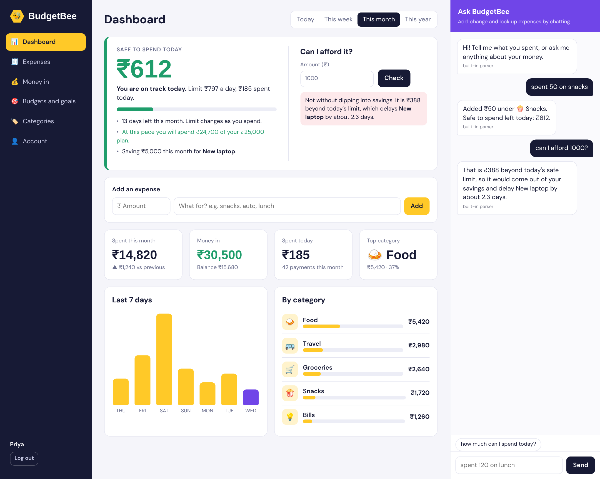
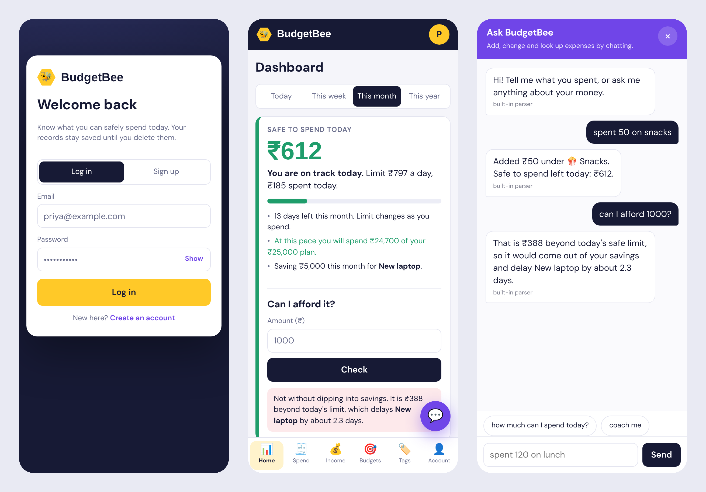

# BudgetBee 🐝

A personal expense and savings tracker that answers one question: **"How much can I safely spend today?"**
Spring Boot + React with a local AI model (Ollama) for chat and coaching. It has **accounts (login and logout)**,
**keeps your records until you delete them**, and **works on your phone**.





## The problem with existing apps

People download expense trackers and abandon them within weeks. User posts and articles repeat the same complaints:

| Complaint | What users say |
|-----------|----------------|
| **They show history, not a decision.** | A month-end chart that says "you spent money" is too late. People prefer one number: how much is left to spend. |
| **Budgets are static and disconnected from savings goals.** | A budget set once becomes irrelevant. Goals sit on another screen, so overspending never shows what it costs your goal. |
| **Tracking is unpaid work.** | Manual entry, endless categories and clean-up make people quit. |
| **Privacy.** | Many apps ask for bank access or upload your data to a cloud. |

## How BudgetBee solves it

**1. A daily "Safe to spend" number that updates itself.**
```
money you can spend this month = income  -  money reserved for savings goals
daily limit                    = (what was left at the start of today) / days left in the month
safe to spend today            = daily limit  -  spent today
```
**2. Goal impact on every decision ("Can I afford it?").** Spending beyond today's limit comes out of your savings.
BudgetBee shows how many days that delays your goal and what it does to your daily limit.

**3. Low-effort entry.** One-line "Add an expense" box, or chat: "spent 50 on snacks". The category is worked out for you.

**4. AI you can trust with money.** A local model writes the coach's tips, but all numbers come from the database.
`NumberGuard` rejects any AI text that contains a number it was not given.

**5. Private by design.** No bank login and no cloud. The AI runs on your machine.


## Try these in the chat

| Say | Result |
|-----|--------|
| `spent 50 on snacks` | adds the expense and shows what is left to spend today |
| `how much can I spend today?` | your safe-to-spend number |
| `can I afford 1000?` | verdict, goal delay and new daily limit |
| `coach me` | AI tip (checked by NumberGuard) |
| `how much did I spend on food this week?` | totals by category and period |
| `set food budget 5000 this month` | budget with 80% warning |
| `save 40000 for laptop` | savings goal |
| `received 5000 salary` | records money in |
| `delete last expense` | undo |

## Architecture

```
React (Vite, PWA) ──► REST API (Spring Boot + Spring Security) ──► H2 file DB  (or MySQL)
                         │
                         ├─ TokenAuthFilter     "Authorization: Bearer <token>" → current user
                         ├─ AuthService         sign up, log in/out, lockout, delete account
                         ├─ PlanCalculator      pure maths: safe-to-spend and what-if (unit tested)
                         ├─ CoachService        facts → local AI text → NumberGuard → fallback template
                         ├─ RuleParser / ChatService   chat understanding with or without AI
                         └─ Budget / Income / Expense services   all scoped to the logged-in user
```

## Tests (26)

`PlanCalculatorTest` (11), `NumberGuardTest` (5), `LoginThrottleTest` (6), `TokenUtilTest` (4).

## API

| Endpoint | Purpose |
|----------|---------|
| `POST /api/auth/register`, `POST /api/auth/login` | create account, log in (returns a token) |
| `POST /api/auth/logout`, `GET /api/auth/me` | log out this device, who am I |
| `POST /api/auth/delete-account` | delete account and all data (needs password) |
| `GET /api/health` | is the server up |
| `GET /api/plan/today`, `GET /api/plan/what-if?amount=`, `GET /api/plan/coach` | safe to spend, can I afford it, AI coach |
| `GET/PUT /api/settings` | expected monthly income |
| `POST /api/chat` | chat assistant |
| `GET/POST/DELETE /api/expenses`, `/api/budgets`, `/api/goals`, `/api/categories` | manage data |
| `GET/POST/PUT/DELETE /api/income...` | money in |
| `GET /api/summary?period=month` | dashboard numbers |
| `POST /api/demo/seed` | load sample data into an empty account |

Everything except register, login and health needs the header `Authorization: Bearer <token>`.

## Project layout

```
start-app.bat / start-app.sh   one-click start
backend/src/main/java/com/budgetbee/
  security/  SecurityConfig, TokenAuthFilter, CurrentUser, TokenUtil, LoginThrottle, PasswordConfig
  model/     User, AuthToken, Category, Expense, Income, IncomeCategory, SenderRule, Budget, SavingsGoal, Settings
  repo/      Spring Data repositories (every query filtered by user id)
  service/   AuthService, PlanCalculator, PlanService, CoachService, NumberGuard, OllamaClient, RuleParser,
             ChatService, ParserService, BudgetService, IncomeService, ExpenseService, DefaultsService, DemoService
  web/       REST controllers
backend/src/test/   unit tests
frontend/           React app (src/App.jsx, api.js, styles.css) and PWA files (public/)
docker-compose.yml  optional MySQL
```
